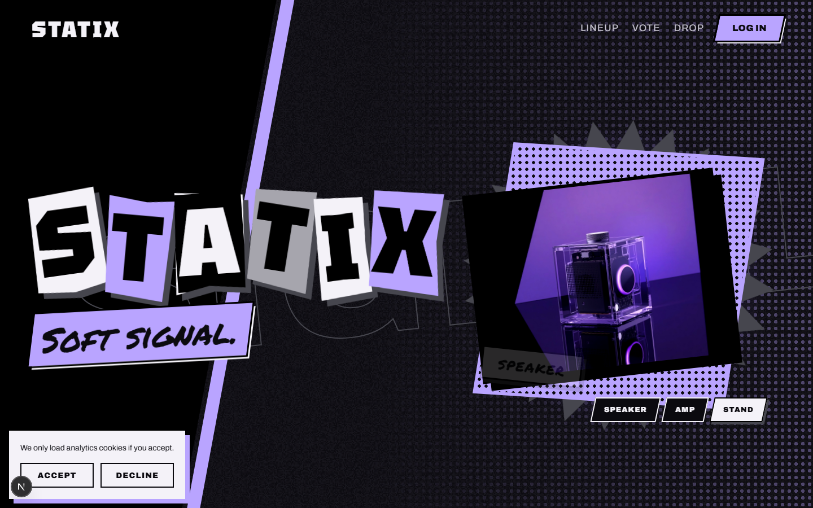
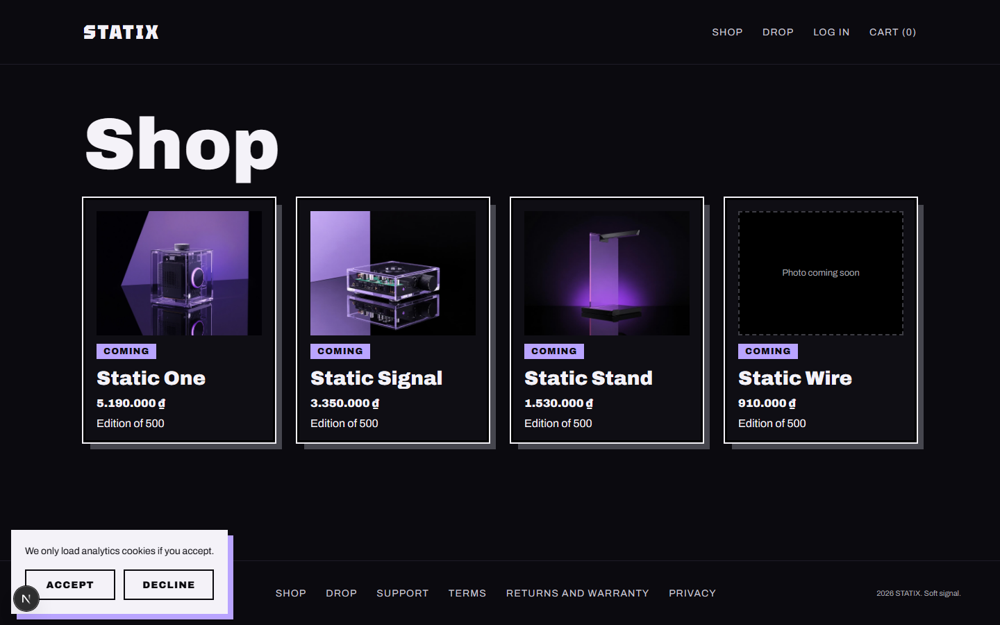
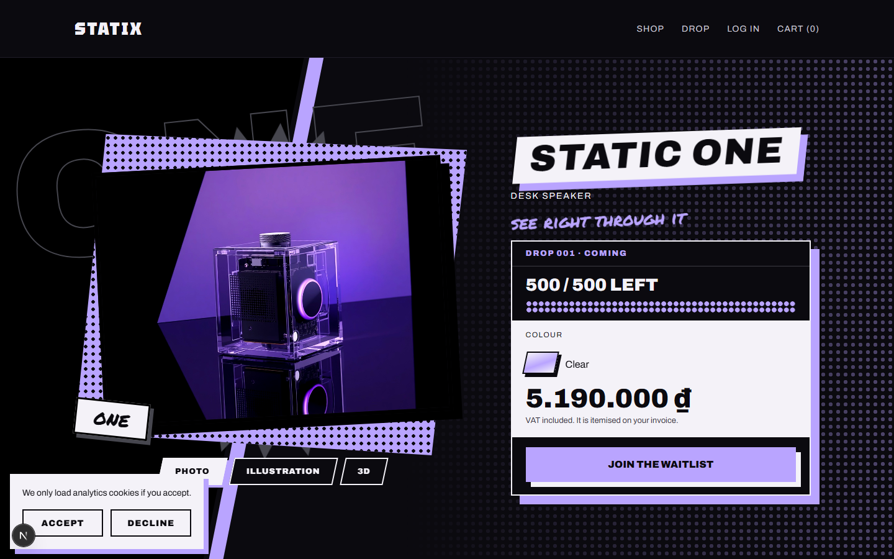
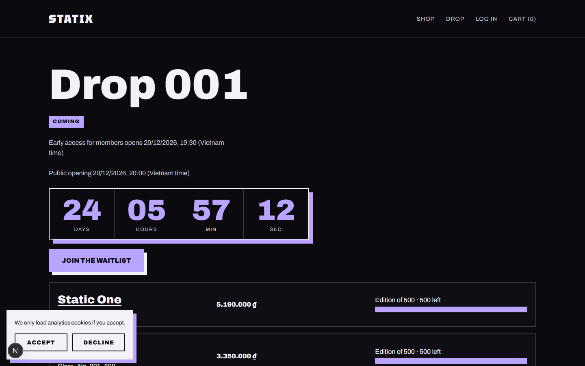
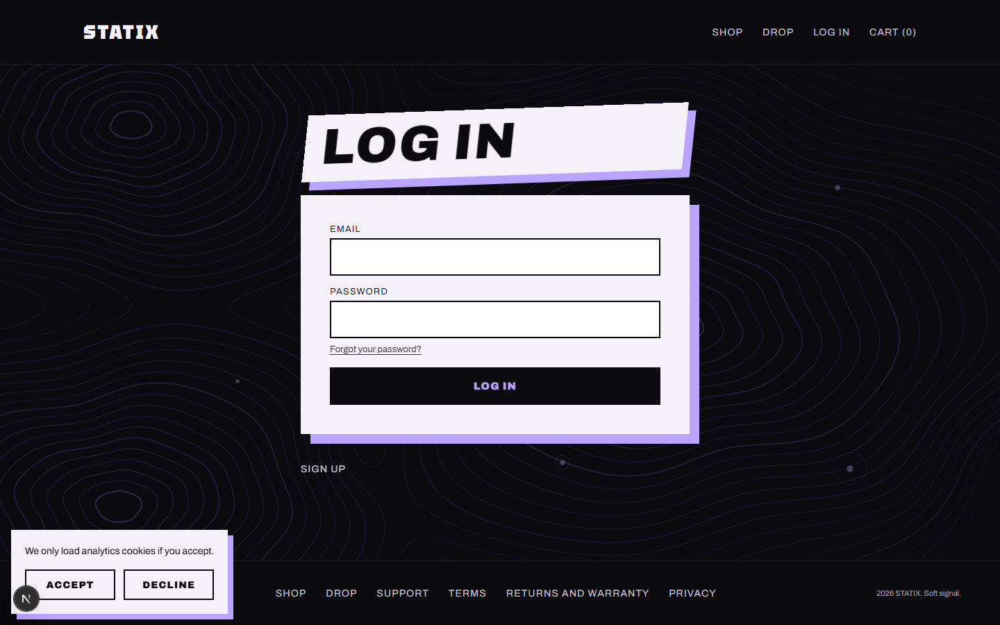

# STATIX

Store for STATIX numbered desk-audio drops. Next.js 16, TypeScript, Postgres with Drizzle, next-intl (English only). Desktop-first.

Plan: [docs/BUILD.md](docs/BUILD.md) · Pages: [docs/PAGES_UI.md](docs/PAGES_UI.md) · Look: [DESIGN.md](DESIGN.md)

## A case study in launch design

STATIX is a fictional first-party audio brand built as a design and product case study. There's no shipped hardware or live store yet. What exists is a complete pre-launch package: a business case, a requirements set, 3D models of the products, a landing page, a login graphic and a full map of every screen.

The brief was simple: make a launch that sells numbered limited drops, and make it feel like the product. The launch system is meant to be buildable by a small team, with the design, the logic and the physical product all pointing the same way.

### What's in the box

| Area | Output | Status |
|---|---|---|
| Business analysis | Market, economics, release strategy, validation gates | Done |
| Requirements | 101 functional requirements (59 Must), 30 non-functional requirements, 15 integrations, 6 process flows, data model, traceability matrix | Done |
| Product design | 3D models of the four products: Static One (speaker), Signal (DAC and amp), Stand, Wire | Speaker, Signal and Stand done, Wire in progress |
| Landing page | Interactive hero, product switcher, live model viewer, colour vote, drop countdown | Built as a static prototype, now in `src/app/(landing)/` |
| Login graphic | Vector illustration tied to the brand's signal theme | Done |
| UI map | Every page, element, state and the requirement behind it: 24 customer pages and 14 admin pages | Done (`docs/PAGES_UI.md`) |
| Storefront | This app | In progress, planned for release R1 |

### The problem

A hardware brand that sells limited drops has to solve several hard problems at once, and each can go wrong in public:

- **Oversell.** Two buyers taking the last unit of a numbered edition is a trust failure, not just a bug.
- **Scarcity without frustration.** A waitlist, early access and fair caps have to feel like a privilege, not a lottery.
- **Trust in payments and data.** Vietnamese buyers pay through VNPay, MoMo and cash on delivery, and the privacy rules are changing.
- **A product that looks like what it is.** A desk audio brand is sold on how it looks on a desk, so the launch material has to be as good as the product.

### Approach

**1. Decide what the store is for before drawing it.** The business analysis set the goal before any screen was drawn: validate demand with a waitlist and a deposit test before committing to a production run. Release gates are tied to measurable results (a waitlist size, a deposit rate, a supplier quote within 20% of the model). Those gates define what gets built first.

**2. Turn the scarcity into rules the database enforces.** A numbered edition must never oversell, so the limit lives in the database, not only in application code:

- Each unit of an edition is a row with a number and a state (Available, Held, Sold, Retired).
- A checkout takes a hold on one unit inside a single atomic step, with a 10-minute timeout.
- Sold and Retired numbers are never reissued, so "No. 042 / 500" stays a real, unique claim.

The acceptance test is concrete: 10,000 concurrent holds on an edition of 50 must produce zero oversells.

**3. Write requirements that trace from goal to test.** Every requirement has an ID, a MoSCoW priority, a release and the goal it serves. Each Must has a user story with Given/When/Then acceptance criteria, and each non-functional requirement has a test case. Anything guessed is marked `[ASSUMPTION]` and anything needing a legal or technical check is marked `[VERIFY]`.

**4. Design the product in 3D before the factory does.** The products were modelled in Blender and exported as GLB files the web app can load directly. The models share one visual language: acrylic with lavender polished edges, black anodised corner caps with hex screws, and lavender lights as the only colour accent.

**5. Build the landing page to test the feeling, not just the copy.** It's a working prototype: a hero that changes product every six seconds (and pauses while the visitor looks at the 3D model), a switcher, a colour vote, a countdown and a waitlist form. Honest limits are written down too. The waitlist is simulated, the vote isn't saved, and there's no pause control at the top of the page, which may fail WCAG 2.2.2.

**6. Map every other screen before building any of them.** The store has 24 customer pages and 14 admin pages. Each one is mapped with every control, its states and the requirement behind it, so the build is decided before code is written. Open questions that change screens are listed at the end of the map.

### Design decisions

- **Scarcity is shown, not hidden.** The public counter is live and within five seconds of the server's count.
- **Cash on delivery stays, with limits.** Many buyers in Vietnam expect it, so it's supported with an order cap and a phone code check.
- **Privacy is part of the product.** Analytics load only after consent, and marketing mail is kept separate from order mail.
- **Accessibility is a requirement.** The lavender accent must pass WCAG 2.2 AA contrast on translucent surfaces, and every interactive element has a keyboard path.

### Stack

| Layer | Choice |
|---|---|
| Web | Next.js 16 with TypeScript, server-rendered product and drop pages for SEO and fast first load |
| Data | Postgres with Drizzle; constraints enforce the unit pool |
| Payments | VNPay and MoMo hosted pages; Stripe for international cards later |
| Shipping | GHN primary, with GHTK and Ahamove as options |
| 3D | GLB models loaded in the browser |
| Testing | Concurrency test, webhook replay test, load test before launch |

### Status

- [x] Business case and validation gates
- [x] Requirements package (11 documents)
- [x] 3D models: Static One, Signal, Stand
- [x] Landing page prototype and interaction notes
- [x] Login graphic
- [x] UI map for all customer and admin pages
- [ ] Wire 3D model
- [ ] Answers to the open questions
- [ ] Storefront build (release R1)

*STATIX is a fictional brand for a design case study. Prices, edition sizes and policies are placeholders marked as assumptions in the requirements.*

## Screenshots

Captured from the local dev server at 1440 × 900.

| Landing (`/`) | Shop (`/shop`) |
|---|---|
| [](docs/screenshots/landing.png) | [](docs/screenshots/shop.png) |

| Product (`/p/static-one`) | Drop (`/drop/001`) |
|---|---|
| [](docs/screenshots/product.png) | [](docs/screenshots/drop.png) |

| Log in (`/login`) | |
|---|---|
| [](docs/screenshots/login.png) | |

## Run it locally

Needs Node 24 and Docker.

```sh
npm install
cp .env.example .env.local   # local defaults work for the database
npm run db:up                # Postgres in Docker
npm run db:migrate
npm run db:seed              # tiers, 4 products, Drop 001 with 500-unit editions
npm run dev                  # http://localhost:3000
```

Checks: `npm run lint`, `npm test`, `npm run build`.

Schema changes: edit `src/db/schema.ts`, then `npm run db:generate` and `npm run db:migrate`.

## Layout

| Path | What |
|---|---|
| `src/app/(landing)/` | Landing page: the original `index.html` markup; script in `public/landing.js` |
| `src/app/(site)/` | Shop, product (`/p/[slug]`), drop (`/drop/[number]`), account and policy pages, inside the shared menu and footer |
| `src/components/` | Shared shell, auth stage and backdrop, catalogue, drop and product views |
| `src/lib/` | Drop status, catalogue/product content and media, auth rules and actions |
| `src/app/globals.css` | Design tokens and the landing styles |
| `src/db/` | Schema and client |
| `messages/` | Page text (English) |
| `docs/screenshots/` | Screenshots shown above |
| `index.html` | Original standalone landing, kept as the reference for `docs/INTERACTABLES.md` |
